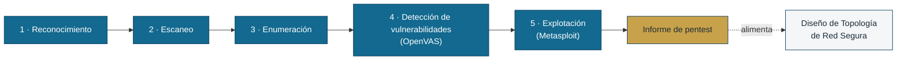

# Entregable final — Módulo I · Objetivo de pentest «Aseguradora Delphos»

Laboratorio para el **entregable final del Módulo I**: una prueba de penetración
completa contra un objetivo realista, cuyo resultado —un informe profesional— se
convierte en la lista de riesgos que el **Diseño de Topología de Red Segura**
(entregable oficial de la insignia) debe mitigar.



Cada fase se apoya en la anterior: lo que enumeras decide lo que escaneas, y lo
que escaneas decide lo que intentas explotar. El informe es el entregable
principal; su apartado de riesgos es, literalmente, la lista de requisitos del
diseño de topología.

- **Enunciado del estudiante:** [`enunciado-pentest-delphos.md`](enunciado-pentest-delphos.md)
- **Guía de herramientas (OpenVAS/Metasploit):** [`plantillas/guia-openvas-metasploit.md`](plantillas/guia-openvas-metasploit.md)
- **Plantilla del informe:** [`plantillas/plantilla-informe-pentest.md`](plantillas/plantilla-informe-pentest.md) 

> ⚠️ **Entorno ficticio y deliberadamente vulnerable.** *Aseguradora Delphos* y
> todos sus datos (personas, CURP, RFC, pólizas, credenciales) son inventados.
> Levántalo **sólo** en la red host-only aislada de VirtualBox. Nunca lo
> expongas a Internet ni a una red de producción.

---

## Qué es

Una sola VM (`delphos-target`). El estudiante ataca desde **su propio Kali**, conectado a
la misma red host-only.


## Topología

```
   HOST (tu equipo)
   └── Red host-only VirtualBox  192.168.59.0/24
        ├── 192.168.59.1   (el host; puedes abrir el sitio en el navegador)
        ├── 192.168.59.10  delphos-target  ← OBJETIVO
        └── 192.168.59.20  tu Kali (lo conectas tú, ver abajo)
```


## Puesta en marcha

Requisitos en el host: VirtualBox 7.x y Vagrant. La primera vez descarga ~1.5 GB
de imágenes Docker, así que hazlo con tiempo e Internet.

```bash
cd mod1_final
vagrant up
# Al terminar verás un bloque "=== Objetivo listo ===".
```

Comprobar que los servicios están arriba:

```bash
vagrant ssh -c "docker ps --format '{{.Names}}\t{{.Status}}'"
```

Apagar / reponer:

```bash
vagrant halt         # apaga sin perder estado
vagrant destroy -f   # borra; la siguiente 'vagrant up' reconstruye desde cero
```

---

## Cómo conectar Kali al objetivo

El objetivo vive en una red **host-only** de VirtualBox (subred
`192.168.59.0/24`). Tu Kali tiene que estar en esa misma red:

1. Con el objetivo ya levantado, en **VirtualBox → Herramientas → Redes
   host-only** localiza la red cuya IPv4 es `192.168.59.1` (la creó Vagrant).
2. **Apaga tu Kali.** En **Configuración → Red → Adaptador 2**: actívalo,
   «Conectado a: **Adaptador sólo-anfitrión**», y elige esa red.
   (Deja el Adaptador 1 en NAT para que Kali conserve Internet.)
3. Arranca Kali y dale una IP en esa red, por ejemplo:
   ```bash
   sudo ip addr add 192.168.59.20/24 dev eth1   # ajusta el nombre de la interfaz
   sudo ip link set eth1 up
   ```
4. Comprueba:
   ```bash
   ping -c2 192.168.59.10
   ```

Desde el propio host también puedes abrir `http://192.168.59.10/` en el
navegador (el host es `192.168.59.1` en esa red).

---

## Estructura

```
mod1_final/
├── Vagrantfile                      # define delphos-target (host-only .10)
├── README.md                        # este archivo
├── enunciado-pentest-delphos.md     # el enunciado del estudiante
├── plantillas/
│   ├── guia-openvas-metasploit.md   # primer de las dos herramientas nuevas
│   └── plantilla-informe-pentest.md # esqueleto del informe a entregar
└── provision/
    ├── setup-delphos.sh             # instala Docker y levanta el compose
    ├── docker-compose.yml           # los cinco servicios vulnerables
    ├── nginx-default.conf           # sirve el sitio; autoindex en /backups/
    ├── web/                         # sitio corporativo ficticio + artefactos
    │   └── backups/                 # config.old y notas de migración filtradas
    ├── tomcat/                      # tomcat-users.xml + context.xml del manager
    └── mariadb/
        └── init.sql                 # esquema + datos personales ficticios
```


