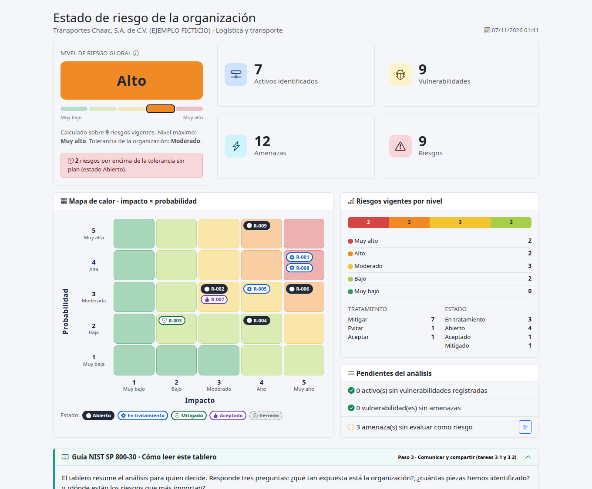
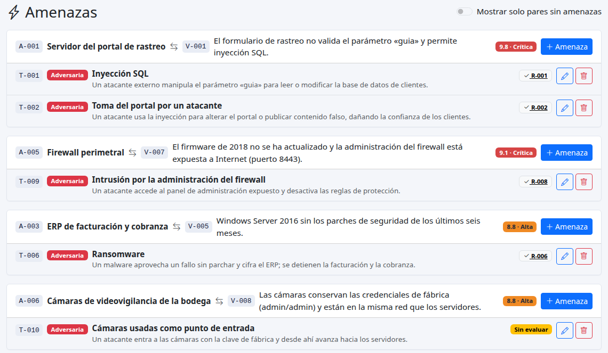
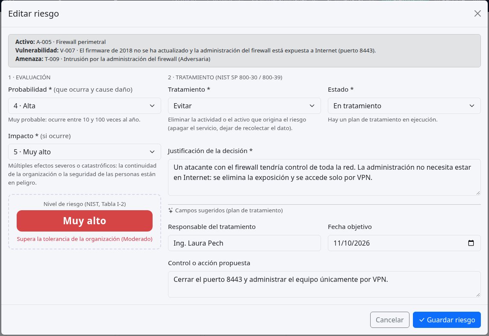
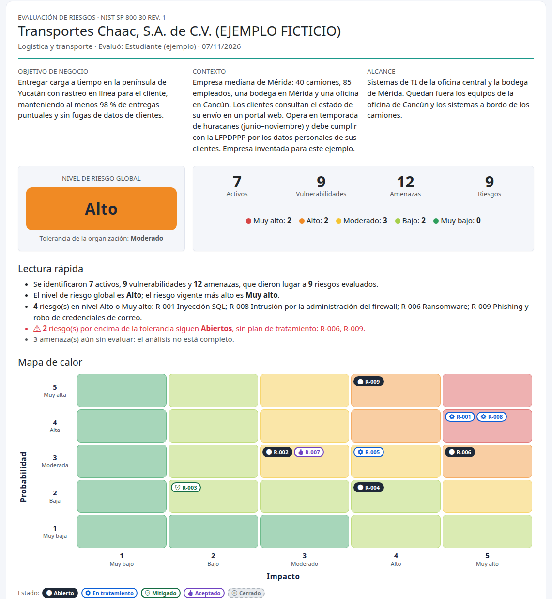
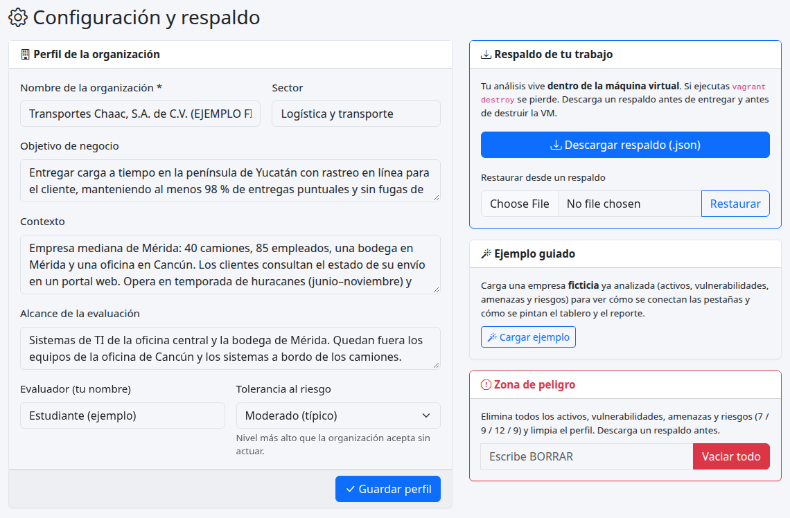

<div class="portada" markdown="1">

<div class="kicker">Certificación en Ciberdefensa Avanzada · Módulo II</div>

# Proyecto final: Evaluación de riesgos de una organización

<div class="subtitulo">Gobernanza Digital: Gestión de Riesgos y Cumplimiento Normativo</div>

| | |
|---|---|
| **Objetivo** | Conducir una evaluación de riesgos (*risk assessment*) sobre la infraestructura de una organización, considerando su objetivo de negocio y su contexto, y comunicar el resultado a la dirección. |
| **Antes de empezar** | Elige la organización que vas a evaluar. Ten a la mano su objetivo de negocio, su infraestructura de TI y a las personas responsables de cada sistema. Necesitas Vagrant ≥ 2.4 y VirtualBox ≥ 7.0, 1.5 GB de RAM y 5 GB de disco libres, y conexión a Internet la primera vez. |
| **Herramienta** | Sistema de Gobernanza y Gestión de Riesgo (aplicación web en una máquina virtual con Ubuntu, Apache y MariaDB). Metodología: NIST SP 800-30 Rev. 1. |
| **URL** | `http://192.168.61.30/` (si no carga: `http://localhost:8080/`) |
| **Entregable** | Resumen ejecutivo en **PDF** · **Fecha de entrega: 15/11/2026** · Medio: **Canvas** |

</div>

## Introducción

Lo que no se identifica no se puede proteger. Una evaluación de riesgos convierte esa idea en un método: primero **qué tienes** (activos), después **qué lo debilita** (vulnerabilidades), **quién o qué lo aprovecharía** (amenazas) y, por último, **qué tan grave sería** y **qué vas a hacer al respecto** (riesgos y su tratamiento).

En este proyecto aplicas ese método a una organización real o realista y dejas el resultado en un sistema que ya trae el modelo de NIST SP 800-30 construido: tú aportas el análisis y las decisiones; el sistema calcula el nivel de cada riesgo, dibuja el mapa de calor y te entrega un reporte. Con ese reporte como base, escribes el documento que sí se entrega: un **resumen ejecutivo** para los niveles gerenciales.

> **Lo que se evalúa no es que encuentres «los» riesgos correctos**, sino que tu análisis sea completo, coherente con el contexto de la organización y esté justificado.

## Resultados de aprendizaje

Al terminar podrás:

1. **Identificar** los activos que sostienen el objetivo de negocio de una organización.
2. **Relacionar** cada activo con sus vulnerabilidades y cada par activo-vulnerabilidad con las amenazas que podrían aprovecharlo.
3. **Analizar** la probabilidad y el impacto de cada amenaza en el contexto de la organización y ubicar el riesgo resultante con la matriz de NIST.
4. **Decidir y justificar** el tratamiento de cada riesgo (mitigar, aceptar, evitar, transferir o compartir).
5. **Comunicar** el estado de riesgo de la organización a quien toma las decisiones, en lenguaje de negocio.

## Paso a paso

### 0 · Levanta el sistema

Desde la carpeta `modulo2/mod2_final/` de tu equipo:

```bash
vagrant up                  # la primera vez descarga la imagen base y tarda unos 4 minutos
```

Al terminar, abre **http://192.168.61.30/** en tu navegador. Si esa dirección no responde (algunos equipos restringen las redes host-only), usa **http://localhost:8080/**.

| Comando | Para qué sirve |
|---|---|
| `vagrant halt` | Apaga la máquina conservando tu trabajo. |
| `vagrant up` | La vuelve a encender. |
| `vagrant provision` | Reinstala la aplicación sin borrar tus datos. |
| `vagrant destroy` | **Elimina la máquina y todo tu análisis.** Haz un respaldo antes (paso 7). |

> **Primera visita.** La pantalla de *Inicio* te muestra los primeros pasos y un botón para **cargar un ejemplo** (una empresa ficticia ya analizada). Úsalo para explorar cómo se conectan las pestañas, y después ve a *Configuración → Vaciar todo* antes de empezar tu análisis. El ejemplo no es una respuesta que se pueda copiar: es otra organización, con otro contexto.



### 1 · Define el contexto (*Configuración*)

NIST llama a este paso *Preparar*: antes de analizar, fija para qué y para quién. Llena el **perfil de la organización**:

- **Nombre y sector.**
- **Objetivo de negocio**: lo que la organización quiere lograr. Es la vara con la que medirás el impacto.
- **Contexto**: tamaño, ubicación, regulaciones aplicables, clientes, temporadas críticas, dependencias de terceros.
- **Alcance**: qué parte de la infraestructura evalúas y qué queda fuera.
- **Tolerancia al riesgo**: el nivel más alto que la organización acepta sin actuar (lo habitual es *Moderado*).

### 2 · Identifica los activos (*Activos*)

Registra un activo por renglón con: fecha, tipo, nombre, departamento, responsable directo, sistema operativo, descripción de su función y **participación** en la función del negocio (*directa*: si falla, el negocio se detiene o se degrada; *indirecta*: lo apoya, pero hay alternativas). Los campos *criticidad*, *clasificación de la información* y *ubicación* son opcionales y te ayudan a estimar el impacto después.

Piensa más allá de los servidores: datos, aplicaciones, servicios en la nube, instalaciones, personas clave y proveedores también son activos. Cada pestaña incluye un panel **Guía NIST SP 800-30** con preguntas para pensar; ábrelo cuando lo necesites.

### 3 · Asigna las vulnerabilidades (*Vulnerabilidades*)

Selecciona un activo y registra cada debilidad que encuentres, con su descripción y su valor **CVSS** (0.0 a 10.0). El sistema te muestra la severidad en vivo.

- Si la debilidad tiene un **CVE**, búscalo en *nvd.nist.gov* y copia el puntaje CVSS 3.x y su vector.
- Si es una debilidad de configuración o de proceso (sin CVE), estima el puntaje con la calculadora CVSS 3.1 de FIRST y pega el vector.

> El CVSS mide qué tan grave es la **debilidad**, no qué tan grave es el **riesgo** para tu organización. Eso lo decides en el paso 5.

### 4 · Identifica las amenazas (*Amenazas*)

La pestaña muestra cada par **Activo ⟷ Vulnerabilidad**. Agrega todas las amenazas que podrían aprovecharlo: un mismo par puede tener varias. Para cada una elige la **fuente** (la taxonomía de NIST) y nombra el **evento**.

| Fuente | Qué es | Ejemplo |
|---|---|---|
| Adversaria | Alguien lo hace a propósito. | Un atacante externo, un empleado malicioso. |
| Accidental | Un error en el trabajo cotidiano. | Un administrador que se equivoca de regla. |
| Estructural | Falla de equipo o software por desgaste u obsolescencia. | Un disco que falla. |
| Ambiental | Desastres naturales o infraestructura externa. | Huracán, incendio, corte de energía. |



### 5 · Evalúa y decide (*Riesgos*)

Cada tupla Activo-Vulnerabilidad-Amenaza aparece como «por evaluar». Para cada una asigna:

- **Probabilidad** (1–5): qué tan probable es que la amenaza ocurra *y* cause un efecto adverso.
- **Impacto** (1–5): qué tanto daña a la organización si ocurre, medido contra su objetivo de negocio.
- **Tratamiento**: mitigar, aceptar, evitar, transferir o compartir, con su **justificación**.
- **Estado**: abierto, en tratamiento, mitigado, aceptado o cerrado.

El sistema calcula el **nivel de riesgo** con la matriz de NIST y lo coloca en el mapa de calor del Inicio. Te avisa si estás aceptando un riesgo por encima de la tolerancia de la organización.



**Escalas de referencia** (adaptadas de NIST SP 800-30, tablas G-3, G-5 y H-3):

| Valor | Probabilidad (ocurre y causa daño) | Impacto (si ocurre) |
|---|---|---|
| **5 · Muy alta / Muy alto** | Casi seguro: más de 100 veces al año o ya está ocurriendo. | Múltiples efectos severos o catastróficos; peligra la continuidad o la seguridad de las personas. |
| **4 · Alta / Alto** | Muy probable: entre 10 y 100 veces al año. | Efecto severo: no se pueden realizar una o más funciones principales; pérdida económica mayor. |
| **3 · Moderada / Moderado** | Algo probable: entre 1 y 10 veces al año. | Efecto serio: las funciones continúan con efectividad muy reducida; pérdida significativa. |
| **2 · Baja / Bajo** | Improbable: menos de 1 vez al año, más de 1 vez cada 10 años. | Efecto limitado: degradación notoria; daño o pérdida menor. |
| **1 · Muy baja / Muy bajo** | Muy improbable: menos de 1 vez cada 10 años. | Efecto insignificante. |

<table class="matriz">
<caption>Matriz de riesgo (NIST SP 800-30, tabla I-2)</caption>
<thead><tr><th rowspan="2">Probabilidad ↓</th><th colspan="5">Impacto →</th></tr>
<tr><th>1 Muy bajo</th><th>2 Bajo</th><th>3 Moderado</th><th>4 Alto</th><th>5 Muy alto</th></tr></thead>
<tbody>
<tr><th>5 Muy alta</th><td class="n1">Muy bajo</td><td class="n2">Bajo</td><td class="n3">Moderado</td><td class="n4">Alto</td><td class="n5">Muy alto</td></tr>
<tr><th>4 Alta</th><td class="n1">Muy bajo</td><td class="n2">Bajo</td><td class="n3">Moderado</td><td class="n4">Alto</td><td class="n5">Muy alto</td></tr>
<tr><th>3 Moderada</th><td class="n1">Muy bajo</td><td class="n2">Bajo</td><td class="n3">Moderado</td><td class="n3">Moderado</td><td class="n4">Alto</td></tr>
<tr><th>2 Baja</th><td class="n1">Muy bajo</td><td class="n2">Bajo</td><td class="n2">Bajo</td><td class="n2">Bajo</td><td class="n3">Moderado</td></tr>
<tr><th>1 Muy baja</th><td class="n1">Muy bajo</td><td class="n1">Muy bajo</td><td class="n1">Muy bajo</td><td class="n2">Bajo</td><td class="n2">Bajo</td></tr>
</tbody></table>

**Respuestas al riesgo** (NIST SP 800-39, a la que remite SP 800-30):

| Tratamiento | Cuándo tiene sentido |
|---|---|
| **Mitigar** | Se puede reducir la probabilidad o el impacto con controles a un costo razonable. Es lo más común. |
| **Aceptar** | El riesgo está dentro de la tolerancia, o el control cuesta más que el daño. Requiere una decisión explícita y justificada. |
| **Evitar** | Se puede eliminar la actividad o el activo que origina el riesgo. |
| **Transferir** | Un tercero absorbe la pérdida (un seguro, un contrato). La responsabilidad ante el cliente sigue siendo tuya. |
| **Compartir** | Se reparte la responsabilidad con otra parte: un servicio gestionado, un SLA, una alianza. |

### 6 · Revisa el tablero y el reporte (*Inicio* y *Reporte*)

*Inicio* te da el **nivel de riesgo global** de la organización, los totales de activos, vulnerabilidades, amenazas y riesgos, y el **mapa de calor**. En el mapa, el color de la celda es el nivel de riesgo y cada ficha **R-00X** es un riesgo; su forma indica el estado. La lista de **pendientes** te dice qué te falta analizar: un activo sin vulnerabilidades puede ser un activo bien protegido… o uno que no has revisado.

La pestaña *Reporte* reúne todos los riesgos de mayor a menor nivel, con su tratamiento y justificación. Puedes **imprimirlo o guardarlo como PDF** y exportarlo a **CSV**. Antes de seguir, hazte tres preguntas: ¿los riesgos más altos son los que más me preocupan?, ¿hay algún riesgo aceptado por encima de la tolerancia?, ¿qué decisión necesito de la dirección?



### 7 · Respalda tu trabajo

Tu análisis vive **dentro de la máquina virtual**. En *Configuración → Descargar respaldo* obtienes un archivo `.json` con todo; guárdalo fuera de la VM. Con él puedes restaurar tu trabajo en una máquina nueva. Haz un respaldo cada vez que termines una sesión y siempre antes de `vagrant destroy`.



### 8 · Escribe y entrega el resumen ejecutivo

Es otro documento, escrito por ti, en PDF. Va dirigido a la **dirección general**: personas inteligentes, con poco tiempo y sin formación en seguridad. Úsalo para informar el estado de la organización desde el punto de vista del riesgo **y para pedir decisiones**.

Una estructura que funciona (de una a dos páginas):

| Sección | Qué debe responder |
|---|---|
| **1. Contexto y alcance** | ¿Qué organización y qué parte de su infraestructura se evaluó, y contra qué objetivo de negocio? |
| **2. Estado de riesgo** | ¿Cómo está la organización hoy? El nivel global, en una frase, y las cifras clave (activos, vulnerabilidades, amenazas, riesgos). |
| **3. Mapa de calor** | Una imagen del mapa que muestre dónde están los riesgos. |
| **4. Riesgos principales** | Los tres a cinco riesgos más importantes: qué puede pasar, qué consecuencia tendría para el negocio y qué se propone. |
| **5. Decisiones solicitadas** | ¿Qué necesita decidir o autorizar la dirección? (presupuesto, aceptar un riesgo, asignar responsables). |
| **6. Próximos pasos** | ¿Qué sigue y cuándo se vuelve a evaluar? |

**Consejos de redacción**

- Habla de **dinero, clientes, continuidad y obligaciones legales**, no de puertos ni de versiones.
- Cada hallazgo importante termina en una **acción** y un **responsable**.
- No incluyas contraseñas, direcciones IP internas ni datos personales reales. Si tu organización es real, pregúntale qué puede compartirse.
- Revisa que lo que dices coincida con lo que está en el sistema: los números del resumen son los del tablero.

## Entregables

1. **Resumen ejecutivo en PDF**, subido a **Canvas** a más tardar el **15/11/2026**.
2. **Respaldo del sistema** (archivo `.json` de *Configuración → Descargar respaldo*) adjunto en la misma entrega, para que tu análisis pueda revisarse.

## Qué se valora

| Aspecto | Qué busca el revisor |
|---|---|
| **Identificación** | Los activos cubren la infraestructura de forma representativa y se vinculan con el objetivo de negocio. |
| **Cadena activo → vulnerabilidad → amenaza** | Cada vulnerabilidad es concreta y tiene amenazas realistas; no hay eslabones sueltos. |
| **Impacto y probabilidad** | Los valores son coherentes con el contexto y se pueden defender. |
| **Tratamiento y justificación** | Cada decisión se explica con costo, tolerancia y evidencia; nada se acepta «porque sí». |
| **Resumen ejecutivo** | Es claro, breve, está en lenguaje de negocio y pide decisiones concretas. |

## Lista de verificación antes de entregar

- [ ] El perfil de la organización está completo (objetivo, contexto, alcance, tolerancia).
- [ ] Ningún activo queda sin revisar sus vulnerabilidades, y ninguna amenaza sin evaluar (el tablero no muestra pendientes).
- [ ] Cada riesgo tiene tratamiento, justificación y estado.
- [ ] Los riesgos aceptados por encima de la tolerancia tienen una justificación sólida.
- [ ] El resumen ejecutivo está en PDF y sus cifras coinciden con el tablero.
- [ ] Descargué el respaldo `.json` y lo guardé fuera de la VM.

## Si algo no funciona

| Síntoma | Qué hacer |
|---|---|
| `http://192.168.61.30/` no carga | Usa `http://localhost:8080/`. En VirtualBox, comprueba que la red host-only `192.168.61.0/24` esté permitida (`/etc/vbox/networks.conf` en Linux y macOS). |
| `vagrant up` falla al descargar la imagen | Revisa tu conexión y vuelve a ejecutar `vagrant up`; es seguro repetirlo. |
| La página muestra un error de base de datos | `vagrant provision` reinstala la aplicación sin borrar tus datos. |
| Quiero empezar de cero | *Configuración → Vaciar todo* (escribe `BORRAR`). Descarga antes un respaldo. |
| Se me perdió el trabajo tras `vagrant destroy` | Vuelve a ejecutar `vagrant up` y restaura tu respaldo en *Configuración → Restaurar*. |

## Referencias

- NIST SP 800-30 Rev. 1, *Guide for Conducting Risk Assessments*: el proceso en cuatro pasos (preparar, conducir, comunicar, mantener), las tablas D-2, G-3, G-5, H-3 e I-2.
- NIST SP 800-39, *Managing Information Security Risk*: las respuestas al riesgo.
- FIRST, *Common Vulnerability Scoring System v3.1*: calculadora y guía de uso.
- NIST *National Vulnerability Database* (`nvd.nist.gov`): búsqueda de CVE y su puntaje CVSS.
